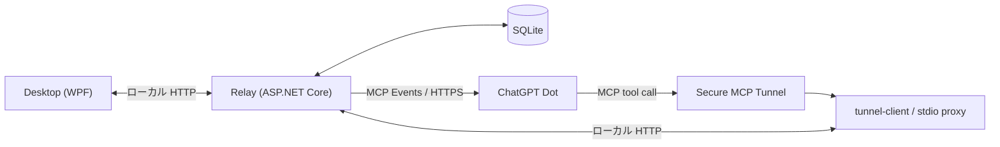

# システム構成

2026-11-25 時点の初期実装の構成を記録する。基準コミット: `707b6d483b9c86db79b2fe292d1e2e532a0ab0a9`。将来構成の確定ではない。

## コンポーネント

| コンポーネント | 役割 |
| --- | --- |
| [Desktop](../src/HagoromoChan.Desktop/) | C# / WPF による会話入力、履歴表示、ローカル Relay との通信 |
| [Contracts](../src/HagoromoChan.Contracts/) | Desktop と Relay の間のメッセージ・状態データ形式 |
| [Relay](../src/HagoromoChan.Relay/) | ASP.NET Core / SQLite、発言・返信・購読・送信待ちの保存、MCP とイベント配信 |
| Secure MCP Tunnel / tunnel-client | ChatGPT クラウドからローカルの stdio アダプターへの公式接続。別プロセス |
| ChatGPT Dot | イベントを購読して依頼に応答し、返信ツールに本文を渡す |
| [Tests](../tests/HagoromoChan.Tests/) | 永続化、重複処理、MCP 等の回帰検証 |

## 現行の責務・制約

- Desktop は OpenAI 固有のイベント送信・署名を直接扱わない。外部プロトコル関連の処理は Relay に配置する。
- Relay は既存の単一チャンネル `hagoromo-mini` を扱い、依頼 ID と返信 ID を対応付ける。MCP ツールは `get_context` と `reply`、イベントは `message.created`。
- ローカル中継はループバックとローカル接続キーで保護し、会話データや認証情報はリポジトリ外に置く。
- HTTP 受領、Dot の実際の応答、Desktop の表示は異なる段階であり、同一の成功状態とみなさない。
- この連携で取得できるのは返信ツール等で明示的に渡された内容であり、公式会話の全履歴や未登録会話の全回答を自動同期する仕様ではない。

起動・接続の既存手順は [README](../README.md) にある。将来の構成変更は合意したマイルストーンで実施し、ここを更新する。

## M08 管理実行環境（実装候補）

単一の [Launcher](../src/HagoromoChan.Launcher/) が Desktop、Relay、公式トンネルとstdioのプロセス寿命を管理する。起動・停止・更新と通常の送受信を分離する。詳細は [M08設計](design/M08-runtime-management.md)・[実機確認](operations/M08-verification.md)。この記述はM08枝の候補で、Windows実機検証後に統合を判断する。
